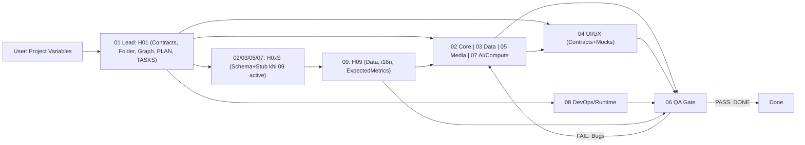

# TỔNG QUAN HỆ THỐNG ROLE AGENT — PHÁT TRIỂN PHẦN MỀM, WEB & AI (GENERIC TEMPLATE)
*Phiên bản: Generic v2.0 · Phạm vi: Web App, AI/ML Tool, SaaS, Desktop, CLI/API (Phi-Game) · Điều phối: Antigravity + Subagent/Swarm, không phụ thuộc API trả phí; trạng thái qua file Markdown + khóa file.*

> [!NOTE]
> Bộ này gồm **9 Role Agent (4 Cốt lõi + 5 Mở rộng)** + giao thức chung [00a_Coordination_Protocol.md](./00a_Coordination_Protocol.md) (**CP**). Chỉ bật đúng role cần thiết qua `ActiveRoles`/`TeamProfile` để tối ưu nhân lực. Mọi Role đọc: `GEMINI.md#Project Variables` (hoặc fallback `Docs/Project_Context.md`) + `00_Overview` §4–5 + CP. Không sửa giá trị dự án vào file Role — chỉ khai báo trong file Variables.

---

## 1. Danh sách Role (4 Cốt lõi + 5 Mở rộng)
| # | Role | Nhóm | File | Dùng khi |
|---|---|---|---|---|
| 01 | Architect & Platform Lead *(kiêm Lead điều phối: `PLAN.md`/`TASKS.md`)* | Cốt lõi | [01](./01_Architect_Platform_Lead.md) | Mọi dự án |
| 02 | Backend & Core Domain Engineer | Cốt lõi | [02](./02_Backend_Core_Engineer.md) | Mọi dự án có Backend/API/Core Logic *(tắt nếu thuần Frontend-only)* |
| 03 | Data, Persistence & Integration Engineer | Mở rộng | [03](./03_Data_Persistence_Integration_Engineer.md) | Có DB / Auth / Billing / Cache / Storage / 3rd-party API |
| 04 | UI/UX & Frontend Engineer | Cốt lõi | [04](./04_UI_UX_Engineer.md) | Mọi dự án có giao diện *(tắt nếu thuần CLI/API)* |
| 05 | Interactive Canvas, Media & Visual Engineer | Mở rộng | [05](./05_Interactive_Media_Visual_Engineer.md) | Có Canvas tương tác (vẽ/mask/editor), WebGL/SVG phức tạp, xử lý ảnh/video (OpenCV/Pillow/FFmpeg) |
| 06 | QA, Testing & Build Verification | Cốt lõi | [06](./06_QA_Verification_Agent.md) | Mọi dự án *(duy nhất đặt `DONE`)* |
| 07 | AI / ML & Compute Engine Engineer | Mở rộng | [07](./07_AI_ML_Compute_Engineer.md) | Có mô hình AI/ML/CV/LLM, tăng tốc phần cứng (CUDA/Intel OpenVINO/DirectML/NPU/MPS), tối ưu RAM/Quantization |
| 08 | DevOps, Runtime & Performance Engineer | Mở rộng | [08](./08_DevOps_Runtime_Performance_Engineer.md) | Cần Docker/CI-CD, script cài đặt/launcher, tải weights & SHA256, Hardware Probe/Telemetry, Profiling |
| 09 | Product Data, Docs & Localization Agent | Mở rộng | [09](./09_Product_Content_Docs_Agent.md) | Có preset/prompt catalog data-driven, đa ngôn ngữ i18n, tài liệu lớn, bảng `ExpectedMetrics` |

## 1b. Cấu hình Tối ưu Nhân lực theo Loại Dự án (`TeamProfile`)
| `TeamProfile` | `ActiveRoles` đề xuất | Role tắt & Tái phân bổ nhanh (`ZoneReassignments`) |
|---|---|---|
| `lean-ai-media` *(vd: AI Watermark Studio)* | `[01, 02, 04, 05, 06, 07]` *(+ `08` nếu setup tự động & Hardware Telemetry)* | Tắt `03` (stateless); tắt `09` (`01/04/07` giữ README, copy UI, presets) |
| `web-saas` | `[01, 02, 03, 04, 06]` *(+ `08, 09` nếu quy mô lớn)* | Tắt `05, 07` |
| `ai-platform` | `[01, 02, 03, 04, 06, 07, 08]` *(+ `05, 09` tùy tính năng)* | Tùy chọn `05, 09` |
| `api-cli` | `[01, 02, 06]` *(+ `03` nếu có DB, + `07` nếu AI, + `08` nếu CI/Docker)* | Tắt `04, 05` |
| `frontend-only` | `[01, 04, 06]` *(+ `05` nếu Canvas/WebGL/WASM, + `09` nếu i18n/docs lớn)* | Tắt `02, 03, 07, 08` |

Role tắt → `01` ghi `ZoneReassignments` trong `PLAN.md` (CP§3). Tuyệt đối không để vùng mồ côi.

---

## 2. Project Variables Interface (template trong `GEMINI.md` hoặc fallback `Docs/Project_Context.md`)
```markdown
## Project Variables
- Identity: ProjectName, SpecPath, AppType(web-app|ai-tool|saas|desktop|cli|api-service|library)
- Stack: BackendStack, FrontendStack, StylingStack, PackageManagers{be, fe}
- Runtime: TargetOS[], HardwareTargets[cpu|nvidia-cuda|intel-openvino|intel-arc|intel-npu|directml|apple-mps], RamBudgetGB, LatencyBudgetMs, ConcurrencyPolicy, ForbiddenAPIs[]
- AI: AiEnabled(bool), Models[], ExecutionBackends[], QuantizationPolicy(fp32|fp16|int8|auto), ModelLoadPolicy(eager|lazy|auto-unload), WeightsDir
- Media: MediaEnabled(bool), CanvasEngine(html5-canvas|konva|webgl|svg|none), VideoPipeline(ffmpeg|none), MaxInputSizeMB, MaxResolutionPx, ColorAlphaPolicy
- Data: DbStack, StorageBackend, AuthMode, BillingFlags{}, MigrationPolicy, IdFormat
- UI: TargetViewports[], ThemeMode(light|dark|system), A11yLevel, Languages[], FontStack, TextLimits{field:maxChars}
- Security: CorsOrigins[], UploadValidation, SecretsPolicy, PrivacyMode(local-only|cloud|hybrid)
- Paths: ProjectRoot, BackendDir, FrontendDir, ContractsDir, DataDir, ModelsDir, TestsDir, ScreenshotsDir, DocsDir, StateDir, BuildsDir, ScriptsDir, [FolderOverrides]
- Process: ActiveRoles[], TeamProfile, ReworkLimit, LockTTL, ExtraProtectedPaths[], ExtraDeletableTemp[]
- Naming: PackageRoot, ApiPrefix, [Overrides cho IConfig/IEventBus/IJobQueue/IStorageService/IAiEngine/IMediaProcessor]
```
Biến thiếu → CP§0 (mặc định cho `Paths/Process`, còn lại `BLOCKED` + hỏi User).

---

## 3. Luồng phối hợp (Phase & Gate)

1. **P0 (User):** điền `Project Variables` trong `GEMINI.md` hoặc `Docs/Project_Context.md`.
2. **P1 (01):** `VarsCheck` → chọn `TeamProfile`/`ActiveRoles`/`ZoneReassignments`, dựng cấu trúc thư mục, `<ContractsDir>`, root config/env, `PLAN.md`, `TASKS.md` (không chu trình) → `H01`. **Role khác chỉ bắt đầu sau `H01 HANDOFF_READY`.**
3. **P2 (Contract-first & Schema-first):** Nếu `09` active, `02/03/05/07` phát `H0xS` → `09` phát `H09`. Song song: `04` dựng UI theo `Contracts` + `mocks/`; `08` dựng scripts/hardware probe.
4. **P3 (Song song theo vùng):** `02, 03, 04, 05, 07, 08, 09` chỉ ghi trong vùng sở hữu. Điểm tuần tự hóa duy nhất: khóa `tasks`, `env`, `runtime`, `db` và root config (`01`).
5. **P4 (QA Gate):** mỗi task `HANDOFF_READY` → `06`: Static → Build/Contract → Functional/E2E → Visual & Resource Gate. `FAIL` → Bug Request (`REWORK n ≤ ReworkLimit`); `PASS` → `DONE`.

---

## 4. Ma trận Sở hữu File (Single-Writer) — đường dẫn mặc định, override qua `Paths`
| Đường dẫn (`<ProjectRoot>` trừ khi ghi khác) | Writer duy nhất | Readers |
|---|---|---|
| `<ContractsDir>` (gốc: OpenAPI spec, shared schemas/protocols), `<BackendDir>/app/config.*`, `<BackendDir>/app/core/base*`, root workspace/dependency manifests (`.env.example`, `pyproject.toml`/`requirements-base.txt` gốc, root `package.json`, shared `tsconfig`/`vite.config`), `PLAN.md` | **01** | Tất cả |
| `<BackendDir>/app/main.*`, `<BackendDir>/app/api/`, `<BackendDir>/app/services/`, `<BackendDir>/app/core/` *(logic nghiệp vụ — trừ `media/` và `engines/`)*, `<BackendDir>/app/schemas/` *(HTTP DTO)* | **02** | Tất cả |
| `<BackendDir>/app/db/`, `<BackendDir>/app/repositories/`, `<BackendDir>/app/auth/`, `<BackendDir>/app/integrations/`, `<BackendDir>/migrations/`, `<ContractsDir>/data/` | **03** | Tất cả |
| `<FrontendDir>/src/pages/`, `<FrontendDir>/src/components/`, `<FrontendDir>/src/hooks/`, `<FrontendDir>/src/store/`, `<FrontendDir>/src/services/` *(API client)*, `<FrontendDir>/src/styles/`, `<FrontendDir>/src/mocks/`, `<ContractsDir>/ui/` | **04** | Tất cả |
| `<FrontendDir>/src/canvas/` *(hoặc `src/media/`, `src/viz/`)*, `<BackendDir>/app/media/` *(OpenCV/Pillow/FFmpeg, mask dilation, EXIF/alpha)*, `<ContractsDir>/media/` | **05** | Tất cả |
| `<TestsDir>/` *(unit, integration, E2E/Playwright, perf benchmarks)*, `<ScreenshotsDir>/`, `<DocsDir>/QA_Reports/`, `<BuildsDir>/` | **06** | Tất cả |
| `<BackendDir>/app/engines/` *(hoặc `app/ml/`: AI model wrappers, OpenVINO/ONNX/DirectML/CUDA/CPU providers, quantization, memory lifecycle)*, `<ModelsDir>/manifest.json`, `<ContractsDir>/ai/` | **07** | Tất cả |
| `<ScriptsDir>/` *(setup, model downloader, hardware diagnostics, start/build launchers)*, `Dockerfile*`, `docker-compose*.yml`, `.github/workflows/`, `<BackendDir>/app/observability/` *(logging, metrics, hardware probe)*, `<ContractsDir>/runtime/` | **08** | Tất cả |
| `<DataDir>/` *(trừ `_stubs/`)*, `<FrontendDir>/src/locales/` *(hoặc `locales/`)*, `README.md`, `<DocsDir>/Guides/`, `<DocsDir>/Benchmarks/` | **09** | Tất cả |
| `<DataDir>/_stubs/<RR>/` | Tác giả schema `RR` ∈ {02,03,05,07} | 09 |
| `<StateDir>/TASKS.md` | Chủ dòng (CP§1) | Tất cả |
| `<StateDir>/Handoff/H*` | Producer (`_reply`: Consumer) | Tất cả |
| `GEMINI.md`, `.agents/**`, `Docs/Roles/[0-9][0-9]*.md` | **Không agent nào** (chỉ User) | Tất cả |
- Thay đổi CORS, root dependencies, biến môi trường chung hoặc cấu trúc `<ContractsDir>` gốc → Request `Config` → `01`.

---

## 5. Nguyên tắc Kỹ thuật Cốt lõi (MỌI Role)
1. **Clean Layered DAG + Contract-First:** `Contracts/Base Config → {Data/Persistence, Media, AI/Compute, Observability} → Backend Services/API → Frontend UI`. Cấm tham chiếu nội bộ ngang module; giao tiếp liên-domain qua Interface/DTO trong `<ContractsDir>`; không hardcode URL, đường dẫn model hay ngưỡng phần cứng.
2. **Hardware-Agnostic & Graceful Fallback:** Chuỗi ưu tiên thực thi: `CUDA / Intel OpenVINO (GPU/AUTO/NPU) / DirectML / MPS → CPU`. Thiếu GPU/NPU, thiếu weights hoặc role mở rộng tắt → fallback an toàn/No-op với thông báo rõ ràng, không crash.
3. **Resource, Memory & Concurrency Safety:** Tôn trọng `RamBudgetGB` & `LatencyBudgetMs`; dùng singleton/lazy-load/auto-unload cho model nặng; tách tác vụ CPU/GPU khỏi async event loop (threadpool/worker queue/semaphore chống OOM); validate kích thước/MIME/magic bytes file upload và CORS.
4. **UI/UX, Accessibility & Visual Fidelity:** Responsive ở mọi `TargetViewports`; tách rạch ròi tọa độ CSS viewport với tọa độ pixel gốc ở Canvas/Media; đầy đủ trạng thái Loading, Progress, Empty, Error và A11y.
5. **Runtime Safety & Verification:** Tuân `CP§5`–`CP§6`; mọi khẳng định "xong/0 lỗi" phải kèm kết quả chạy kiểm tra thực tế sau chỉnh sửa cuối.
